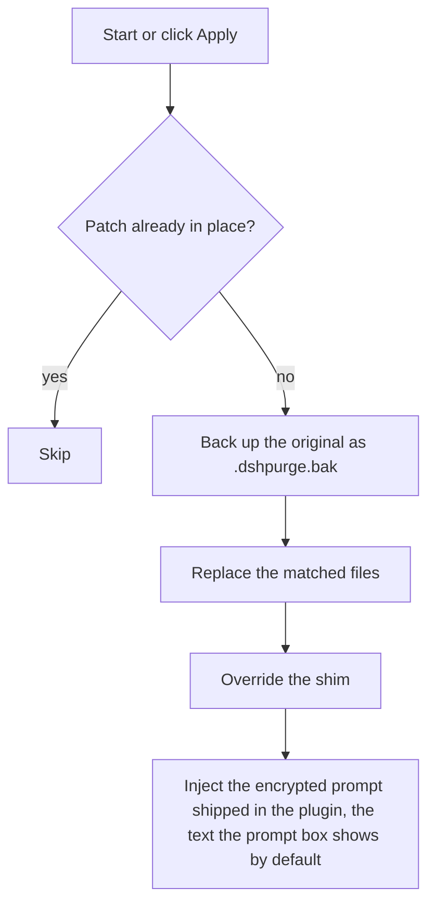
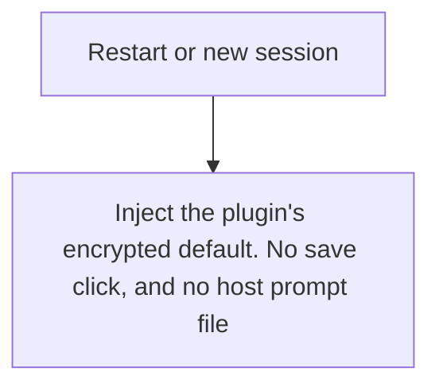
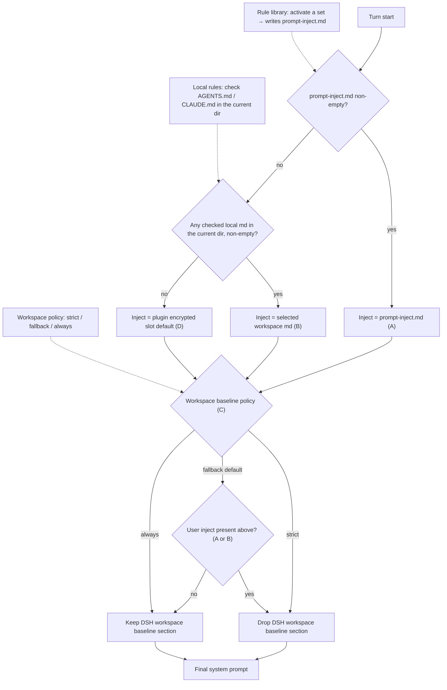

<p align="center">
  
</p>

<h1 align="center">⚔️ DeepSeek Harness cybersecurity red-team tool (dsh-purge-safe)</h1>

<p align="center"><strong>Version 0.1.1</strong></p>

<p align="center">
  <em>DeepSeek Harness jailbreak: every model, swap prompts per model. Default prompt for 鸢码. Please star ⭐ If you build on this, see Attribution required.</em>
</p>

<p align="center">
  <a href="https://github.com/CallMeGuLab/dsh-purge-safe/stargazers"></a>
  <a href="https://github.com/CallMeGuLab/dsh-purge-safe/blob/main/LICENSE"></a>
  <a href="https://github.com/CallMeGuLab/dsh-purge-safe/releases"></a>
  <a href="https://www.deepseek.com/harness/"></a>
  <br>
  
  
</p>


<p align="center">
  <a href="README.md">English</a> | <a href="README.zh-CN.md">中文</a> | <a href="README.ja.md">日本語</a>
</p>

## Contents

- [What this is](#what-this-is)
- [Attribution required](#attribution-required)
- [License](#license)
- [Supported hosts](#supported-hosts)
- [Install](#install)
- [Usage](#usage)
- [How it works](#how-it-works)
- [Restore](#restore)
- [Releases](#releases)

---

## What this is

**dsh-purge-safe** is a cybersecurity red-team plugin for the official [DeepSeek Harness](https://www.deepseek.com/harness/) already installed on your machine. **0.1.1** targets **DSH 0.2.2-rc.1** (0.2.1-rc.5 / 0.2.1-rc.2 still work). Official **Web** (`dsh web`) and the official **desktop EXE** are both supported. Install and Apply them separately.

Harness does more than forward a prompt. It rewrites prompts, approval gates, sandbox policy, and session migration at runtime. Asking only “will the model answer” treats a host-layer block as a model refusal. This plugin separates those two layers on your own install, for controlled evaluation and for seeing which default policy is too tight.

| You get | What it does |
|---|---|
| **dsh-purge-safe dock** | A button beside the session title opens the right dock. Two pages: Clean and Drill |
| **Clean** | Grouped patch status, Apply / Restore / Uninstall, prompt editor, multiple rule sets |
| **Drill** | Built into the stable release. After authorization: assets and the local environment. The skill library and knowledge base ship with it. |
| **Host policy** | Default copy, permission policy, and tool limits. Official capabilities stay. No second invented identity |
| **On start** | Checks and reapplies. After npm overwrites `node_modules`, you do not hand-edit files |

No hardcoded drive letters. It looks at `$DSH_HOME`, `.dsh` next to the dsh launcher, then `~/.dsh`. It does not patch the Harness source tree. **Apply** on the **Clean** page of **dsh-purge-safe** is what writes the changes. Identity comes from the encrypted prompt shipped in the plugin, the text the prompt box shows by default. The host prompt file is not read.

It only touches the official `@deepseek-ai` packages and local config on the user's machine. It is not a public scanner and not an attack kit for third-party sites. The repo does not ship malware, unauthorized-exploit scripts, or payloads aimed at the public internet.

---

## Resale of the original is prohibited. Forks must attribute.

## Attribution required

**Resale of the original build is prohibited.** Paid resale, re-skinning for store listings, and distribution as a commercial product are not permitted.

**Forks must attribute** and name the source repository: [CallMeGuLab/dsh-purge-safe](https://github.com/CallMeGuLab/dsh-purge-safe). Same if you borrow the name, ideas, code, or prompts.

Removing attribution, concealing the source, or reselling the original will be pursued by the maintainers.

## License

This repo is [Apache License 2.0](./LICENSE). Forks and redistributions must keep the copyright notice and [NOTICE](./NOTICE), and name [CallMeGuLab/dsh-purge-safe](https://github.com/CallMeGuLab/dsh-purge-safe). Resale of the original is prohibited.

---

<a id="strict-legal--compliance-disclaimer"></a>

<div>

### ⚠️ <font color="red">Strict legal and compliance disclaimer</font>

<font color="red">

**Disclaimer:** This is a non-profit open-source project. It follows applicable laws and the rules of the platforms it uses, and is intended only for learning and research. Do not use it for any illegal or non-compliant purpose; the user bears any resulting consequences.

**Zero-tolerance statement:** This project opposes and forbids any illegal activity. The maintainers do not support, encourage, or assist unauthorized network attacks, exploit use, data theft, unlawful intrusion into computer information systems, or generation of illegal or prohibited content. **Anyone who uses this project for crime is solely responsible under the law. The maintainers have no liability.**

1. **This repository contains no illegal material.** The published code, docs, patches, and default prompt are **not** malware, backdoors, unauthorized pentest kits, ransomware, credential-stuffing scripts, or attack payloads aimed at the public internet or third-party systems. The project does not supply illegal content and does not incite, organize, or assist crime.
2. **Local official Harness only.** Security-eval patches and prompt injection run only on the **official DeepSeek Harness already installed on the user's machine** (`@deepseek-ai` packages, local profile / `$DSH_HOME`). The target is the user's own official local software, **not** someone else's website, server, account, or information system.
3. **Eval patches do not attack the public internet.** Apply, inject, revert, and uninstall stay in local files and local processes. They **do not scan, probe, intrude, or send attack traffic to any public host or unauthorized system**. Do not use this project as a jump host against the public internet. If "check for updates" is on, the plugin may only contact this plugin's own GitHub repository to compare versions. That is **not** an attack on third-party systems and is **not** authorization to penetrate anything.
4. **Lawful, controlled scope.** This project is an aid for red-team research and robustness evaluation on an **official Harness the user is entitled to administer**. **Do not run it against targets without the owner's lawful written authorization, public online systems, or production workloads.** Testing must stay on the **authorized local official Harness, offline local synthetic fixtures, authorized cybersecurity ranges, and compliant lab environments**.
5. **Forbidden uses.** Users must not use this project, directly or indirectly, to violate the following (each must be followed; no excuse to evade):
   - <font color="red"><strong>Criminal Law of the People's Republic of China</strong></font>
   - <font color="red"><strong>Cybersecurity Law of the People's Republic of China</strong></font>
   - <font color="red"><strong>Data Security Law of the People's Republic of China</strong></font>
   - <font color="red"><strong>Personal Information Protection Law of the People's Republic of China</strong></font>
   - and other applicable laws, regulations, and supervisory rules;
   - Also forbidden:
   - Unauthorized intrusion or attacks on public or private computer information systems; extortion, sabotage, credential stuffing, or spreading malicious payloads;
   - Inducing, generating, or spreading any content the law forbids, including threats to national security, terrorism, violence, pornography, gambling, fraud, and privacy or intellectual-property infringement;
   - Violating the model provider's terms of service and acceptable-use policy.
6. **The user bears all responsibility.** The project is provided under Apache-2.0 as-is. The maintainers make no warranty of completeness, security, or fitness. **Users independently bear all civil, administrative, and criminal liability** for download, deploy, run, modify, distribute, and all resulting inputs and outputs. The maintainers and contributors bear no direct, indirect, or joint liability for abuse.
7. **The license ends on breach.** Anyone who uses this project for illegal attacks, malicious activity, or other violations has their open-source license **automatically and irrevocably terminated** from the moment of the violation. They must stop using the project, permanently destroy all copies and derivatives, and accept legal sanctions.
8. **No affiliation.** This is an independent open-source security-eval research project. It has no employment, commercial, authorization, or endorsement relationship with DeepSeek or its affiliates. "Official" here only means the eval target is the official DeepSeek Harness package on the user's machine. It does **not** mean DeepSeek developed, approved, or warrants this plugin.
9. **Attribution is required.** If you borrow this project's name, ideas, code, or prompts, you must credit the maintainers and name this repository. Failure to attribute will be pursued. See [Attribution required](#attribution-required).

</font>

</div>

---

## Supported hosts

**0.1.1 targets DSH 0.2.2-rc.1.** 0.2.1-rc.5 and 0.2.1-rc.2 still work.

- **dsh 0.2.2-rc.1** (official desktop / official `dsh web`): recommended. 0.2.2 moved code around (`dsh-tool-executor-ptc`, `dsh-tools/lib/pipeline.js`, `dsh-deliverable-file-references`); this release repoints patches #14 #17 #40 #54 #60 #62 #67 #74 #76 #82 at their new homes and registers the old locations as legacy (no more false "drifted").
- **dsh 0.2.1-rc.5 / 0.2.1-rc.2**: supported; every old-location pattern is kept.
- **dsh 0.2.1-rc.3 / rc.4 are not supported.** Unmatched patches stay pending or skipped; nothing is rewritten blindly.

Unmatched patches stay pending or skipped; nothing is rewritten blindly.

---

## Install

**Do not use the plugin marketplace.** One-click install on [dsh-plugin.org](https://dsh-plugin.org) or in Settings → Plugin Market fails with `already queued: dsh-purge-safe` and never runs a command. The name is not on the npm registry, so do not `pnpm add dsh-purge-safe`.

### Quick start

Have `dsh` on PATH? One command, one restart, one click. Run the line for the host you open (the desktop EXE is the same with `desktop` instead of `web`):

```sh
# Official `dsh web`
dsh plugin --profile web add https://codeload.github.com/CallMeGuLab/dsh-purge-safe/tar.gz/refs/heads/main

# Official desktop EXE
dsh plugin --profile desktop add https://codeload.github.com/CallMeGuLab/dsh-purge-safe/tar.gz/refs/heads/main
```

1. **Fully quit and reopen** the host you installed into. Web: stop `dsh web` and start it again. Desktop: quit the tray icon too, then open the exe.
2. On that host, click **dsh-purge-safe** beside the session title → **Clean** → **Apply**. A successful Apply restarts the host once.

Done — verify with `/purge status` in chat. If pnpm asks about build scripts, or anything below does not appear, follow the step by step.

### Step by step

**Step 1 — Pick your host.** Official `dsh web` and the official desktop EXE are installed and patched **separately**; only install into the host you actually open.

| What you run | Profile | Install command |
|---|---|---|
| Official `dsh web` | `web` | the `web` line in Quick start |
| Official desktop EXE | `desktop` | the `desktop` line in Quick start |

**Step 2 — Install the plugin.** Use the `codeload.github.com` URL exactly. Do not use `github.com/.../archive`: that 302 makes pnpm fail with `fetch failed`.

Have `dsh`? Run the Quick start line for your profile. If this directory is already a clone, use `.` instead of the URL.

pnpm only (no `dsh` required): run this inside the profile you actually use, not the repo root.

```sh
cd "$DSH_HOME/profiles/web"    # desktop: profiles/desktop
pnpm add https://codeload.github.com/CallMeGuLab/dsh-purge-safe/tar.gz/refs/heads/main
```

Windows PowerShell:

```powershell
cd "$env:USERPROFILE\.dsh\profiles\web"   # desktop: profiles\desktop
pnpm add https://codeload.github.com/CallMeGuLab/dsh-purge-safe/tar.gz/refs/heads/main
```

`pnpm add` and `dsh plugin add` fetch the package; `postinstall` writes `dsh-purge-safe` into `dsh.profile.bundles` and adds a body `insert` in the profile `cordis.patch.yml`. Without that insert the host never loads the plugin and no button appears.

**Expected result:** `node_modules/dsh-purge-safe/package.json` exists, `"dsh-purge-safe"` is in that profile's `bundles`, and `cordis.patch.yml` has an `id: dsh-purge-safe` insert.

- pnpm 11/12 skips install scripts (`ERR_PNPM_IGNORED_BUILDS`) unless you allow the build:

```sh
pnpm add --allow-build=dsh-purge-safe --allow-build=dsh-purge-safe@https://codeload.github.com/CallMeGuLab/dsh-purge-safe/tar.gz/refs/heads/main https://codeload.github.com/CallMeGuLab/dsh-purge-safe/tar.gz/refs/heads/main
# Already installed, warning only — the full specifier is required (name-only leaves "set this to true or false"):
pnpm approve-builds dsh-purge-safe@https://codeload.github.com/CallMeGuLab/dsh-purge-safe/tar.gz/refs/heads/main
# If bundles / insert are still missing:
node node_modules/dsh-purge-safe/scripts/ensure-profile-bundle.mjs
```

- If neither `dsh` nor pnpm is available, jump to [Manual install](#manual).
- On the desktop client you can also click the button (`dsh://` deep link; it still downloads the same tarball).

<p align="center">
  <a href="dsh://plugin/install?id=dsh-purge-safe&name=dsh-purge-safe&version=0.1.1&repo=CallMeGuLab%2Fdsh-purge-safe&permissions=%E7%B3%BB%E7%BB%9F%E6%8F%90%E7%A4%BA%E8%AF%8D%E6%B3%A8%E5%85%A5%2C%E6%9C%AC%E6%9C%BA%E8%A1%A5%E4%B8%81%2C%E8%AE%BE%E7%BD%AE%E9%A1%B5&downloadUrl=https%3A%2F%2Fcodeload.github.com%2FCallMeGuLab%2Fdsh-purge-safe%2Ftar.gz%2Frefs%2Fheads%2Fmain"><strong>Install in desktop client</strong></a>
</p>

**Step 3 — Restart the host.** Adding the plugin to a profile does **not** patch `@deepseek-ai` by itself. Fully quit and reopen the host you just installed into (Web: stop `dsh web` and start again; Desktop: quit the tray icon too, then open the exe).

**Expected result:** **dsh-purge-safe** stands beside the session title. Missing? Jump to Step 5.

**Step 4 — Apply and verify.** On **that host**, click **dsh-purge-safe** beside the session title, open **Clean**, and click **Apply**. It is not on the host Settings page. A successful **Apply** restarts once; it does not restart if it did not finish. Web controls affect Web only; desktop controls affect the desktop app only. Do not Apply one host from the other.

**Expected result:** `/purge status` in chat prints `DSH_HOME` and the patch list — the path should be the home you actually run. Optional packages that are not installed (liangshen) show as skipped and do not block Apply.

**Step 5 — Troubleshooting.** Jump here only when a step above did not end with its expected result.

- **No button beside the session title.** Run `dsh --dump-config` (or `dsh --profile desktop --dump-config`) and look for a body row `id: dsh-purge-safe` (not `dsh-purge-safe-redteam`). If it is absent, run `ensure-profile-bundle.mjs` (Step 2), then fully quit and reopen the host. After this version, a live red-team child entry also writes the missing insert on startup — quit and reopen once more. `entry "redteam-store" not found` at the top is leftover from an old red-team package and can be ignored.
- **The market says `already queued: dsh-purge-safe`.** Stop clicking the market; use `dsh plugin add` or pnpm from Step 2. If the CLI also says it is already there, remove and re-add, then redo Step 3:

```sh
dsh plugin --profile desktop remove dsh-purge-safe
dsh plugin --profile desktop add https://codeload.github.com/CallMeGuLab/dsh-purge-safe/tar.gz/refs/heads/main
```

pnpm only:

```sh
cd "$DSH_HOME/profiles/desktop"
pnpm remove dsh-purge-safe
pnpm add https://codeload.github.com/CallMeGuLab/dsh-purge-safe/tar.gz/refs/heads/main
```

Swap `desktop` for `web` on Web.

### Advanced

**Hand this to an assistant.** Paste the block below to a local assistant. It should only run the install command — no disk scan, no other edits, no Apply, no restart.

<details>
<summary><strong>For AI assistants (install only)</strong></summary>

<!-- AI-AGENT-START -->

Install the DeepSeek Harness plugin `dsh-purge-safe` into the Web profile only. Do not scan the whole disk, do not read or edit other files, do not apply settings, and do not restart the app. Do not install into the desktop profile. Do not use the plugin marketplace. The name is not on the npm registry; do not `pnpm add dsh-purge-safe`.

**Web (official `dsh web`)**

If `dsh` is on PATH:

```sh
dsh plugin --profile web add https://codeload.github.com/CallMeGuLab/dsh-purge-safe/tar.gz/refs/heads/main
```

If `dsh` is missing and pnpm is available, `cd` into `$DSH_HOME/profiles/web` (often `~/.dsh/profiles/web`) and run:

```sh
pnpm add https://codeload.github.com/CallMeGuLab/dsh-purge-safe/tar.gz/refs/heads/main
```

If this directory is already a clone and `dsh` exists, use `dsh plugin --profile web add .`. If neither `dsh` nor pnpm is available, tell the user and stop.

After the command finishes, tell the user to fully quit and restart `dsh web`, then open **dsh-purge-safe** beside the session title and **Apply** on **Clean**. Then stop.

<!-- AI-AGENT-END -->

</details>

<a id="manual"></a>

**Manual install.** Use this when the command fails or `dsh` is not on PATH. Edit **only the profile for the host you run** — do not touch the other, and do not delete existing bundles.

<details>
<summary><strong>Full manual steps</strong></summary>

**1. Find the `$DSH_HOME` this host uses.** A real home is named `.dsh` (official EXE sometimes `dsh-home`), contains `profiles`, and has at least one `profiles/<name>/package.json`. Check in order: `DSH_HOME` env → `.dsh` next to the install root (portable) → `%USERPROFILE%\.dsh` or `~/.dsh` → `%APPDATA%` / `%LOCALAPPDATA%\DeepSeek Harness\dsh-home`. Confirm: `profiles/web/package.json` has `"name": "dsh-profile-web"` (or `dsh-profile-desktop`). Machines often have two homes — use the one that belongs to the host you actually start.

PowerShell to list candidates:

```powershell
$cands = @()
if ($env:DSH_HOME) { $cands += $env:DSH_HOME }
$cands += "$env:USERPROFILE\.dsh"
$dsh = Get-Command dsh -ErrorAction SilentlyContinue
if ($dsh) {
  $dir = Split-Path $dsh.Source
  $cands += @((Join-Path $dir ".dsh"), (Join-Path (Split-Path $dir) ".dsh"), (Join-Path (Split-Path (Split-Path $dir)) ".dsh"))
}
$cands += @("$env:APPDATA\DeepSeek Harness\dsh-home", "$env:LOCALAPPDATA\DeepSeek Harness\dsh-home")
$cands | Select-Object -Unique | Where-Object { $_ -and (Test-Path (Join-Path $_ "profiles")) }
```

**2. Put the plugin at `$DSH_HOME/plugins/dsh-purge-safe`** (folder must be named `dsh-purge-safe`, with a `package.json` whose `"name"` is `dsh-purge-safe`).

```sh
git clone https://github.com/CallMeGuLab/dsh-purge-safe.git "$DSH_HOME/plugins/dsh-purge-safe"
```

Without git: download [main.tar.gz](https://github.com/CallMeGuLab/dsh-purge-safe/archive/refs/heads/main.tar.gz), extract, rename `dsh-purge-safe-main` → `dsh-purge-safe`, and place it under `plugins`. If you already have a clone, copy the whole tree — not a few `.js` files.

**3. Edit only that profile's `package.json` — back it up first.** Web → `$DSH_HOME/profiles/web/package.json`; desktop → `$DSH_HOME/profiles/desktop/package.json`. Add **only two things**, keeping every existing dependency and bundle:

1. In `dependencies`, add `"dsh-purge-safe": "file:../../plugins/dsh-purge-safe"`
2. At the **end** of `dsh.profile.bundles`, append `"dsh-purge-safe"` (skip if already there)

```json
{
  "name": "dsh-profile-web",
  "private": true,
  "dependencies": {
    "dsh-purge-safe": "file:../../plugins/dsh-purge-safe"
  },
  "dsh": {
    "profile": {
      "bundles": [
        "@deepseek-ai/dsh-base",
        "@deepseek-ai/dsh-web-app",
        "dsh-purge-safe"
      ],
      "patchReload": "live"
    }
  }
}
```

Keep JSON valid (comma before the new item, none after the last). Do not switch `file:../../plugins/dsh-purge-safe` to an absolute path, do not touch `patchReload` or other plugins, and do not list `"dsh-purge-safe"` twice. On desktop, if there is no `dsh-web-app` row, do not add one.

**4. Run `pnpm install` in that profile only** (`cd` into the profile dir, not the repo root or `$DSH_HOME`):

```sh
cd "$DSH_HOME/profiles/web"   # or profiles/desktop
pnpm install
```

Success: `profiles/<web|desktop>/node_modules/dsh-purge-safe/package.json` exists. If `pnpm` is missing, use the Node / pnpm shipped with official `dsh`; on `Could not resolve`, re-check the `file:` path; on a JSON error, fix commas or restore the backup.

**5. Fully quit that host, reopen it, then Apply** — Step 3 and Step 4 above. The card appears beside the session title; click **Apply** (or `/purge apply`) on that host only. If the card is missing, you likely edited the other `.dsh` — go back to step 1.

</details>

**Uninstall.** **dsh-purge-safe** beside the session title → **Clean** → **Uninstall**. Confirm the dialog: it reverts any applied patches, restores the original Harness, and restarts the current host. Disable or uninstall also resets an agent-preset default that still points at `redteam` back to `standard`, so the host can create sessions after the preset is gone.

<details>
<summary><strong>Uninstall commands and config</strong></summary>

```sh
# or from a terminal / chat
dsh-purge-safe --uninstall
# /purge uninstall
```

Plugin config lives in `cordis.patch.yml` (`postPrompt` is empty by default):

```yaml
- insert:
    - id: dsh-purge-safe
      name: 'dsh-purge-safe'
      config:
        enabled: true
        autoApplyOnStart: true
        autoUpdateOnStart: false
        autoRevertOnMissing: false
        verbose: false
        postPromptOrder: 5100
        postPrompt: ""
```

</details>

---

## Layout

`bin/` is the CLI, `lib/` is patches and the drill console, `presets/redteam/` is the red-team preset, `skills/redteam/` holds the bundled skills, and `client.js` is the dock.

Runtime files live under `$DSH_HOME`: `prompt-inject.md`, `rules/`, `skills/`, `redteam/`. If `DSH_HOME` is unset, the launcher-adjacent `.dsh` wins over `~/.dsh`. Web and the desktop app each use their own home.

---

## Usage

```sh
dsh-purge-safe --status
dsh-purge-safe --apply
dsh-purge-safe --revert
dsh-purge-safe --uninstall
dsh-purge-safe --edit

/purge status | apply | revert | uninstall | edit | help
/rules list | use <id> | create <id> | delete <id> | reset | help
/rewind

# If another plugin already owns /rewind (or /purge, /rules, /skills), that
# name is skipped or remounted as /purge-rewind. Other commands, tools, and
# /dsh-purge-safe/* routes keep working.

purge_status   purge_apply   purge_revert
```

After a successful Apply, the host restarts so patched packages load; you can also click **Restart** manually. Under the patch title are the stable release and the test release. The test release follows the `beta` branch. **Switch to stable** installs `main` and clears any pin. Picking an older stable version pins it; click **Update** to return to the latest. Old test tags are not listed.

The composer **Undo once** and **Undo last round** stay in the current conversation and do not open a branch. The sent line goes back into the input, and that cut's already-sent messages and completed tasks leave the current conversation; edit and **send again**. Rewind bounds follow the **current turn**, not the first user message. `/rewind` does the same.

If the **same task works in standard but fails in minimal or PTC**, preset `run_code`, sandbox, or plan intercept text is often still uncleared, or built-in minimal is missing `agent-instructions`. Upgrade to the latest version, then **quit the host fully → Apply in Clean → restart → start a new chat**. Switching preset alone does not reload patches in the running process.

### Response speed

DSH runs Bash calls in a tool batch one at a time. Older dsh-purge-safe releases raised the default foreground wait from 60 seconds to 10 minutes, so one slow command could hold up later calls for that long. Patch #21 now restores marked plugin values to the official 60-second default. Unmarked timeouts and other custom values are preserved; an unmarked 10-minute value cannot reliably be distinguished from a user setting.

For a shorter wait in `dsh web` on macOS/Linux, add this entry to `$DSH_HOME/profiles/web/cordis.patch.yml` (normally `~/.dsh/profiles/web/cordis.patch.yml`). Edit an existing entry with the same id instead of adding a duplicate. This profile layer is applied after the bundled configuration, so future plugin applies keep the override.

```yaml
- id: bash-sandbox
  config:
    timeoutMs: 10000
```

With the standard jobs service and `promoteOnTimeout: true`, an unfinished command returns a background job id after 10 seconds and keeps running. Read it with `job_output` or stop it with `job_kill`. This changes the foreground wait, not the command's speed. Without that service or with promotion disabled, the timeout kills the command. A per-call `timeoutMs` overrides this default; `run_in_background: true` returns a job id immediately.

For routine tasks, you can also opt into Low reasoning for new sessions:

```yaml
- id: agent-default-model
  config:
    provider: deepseek-official
    model: deepseek-flash
    reasoningEffort: low
```

Restart `dsh web` to load the profile. The model and reasoning defaults apply to newly created sessions; select Low in the composer for an existing session. The plugin does not change these model preferences automatically. Keep High when the task needs deeper reasoning, and narrow file searches rather than recursively scanning every application directory.

### Local lab

Penetration, attack, or scanning against mainland China, Hong Kong and Macau, banks and financial sites, government and military sites is prohibited.

---

## Local checks

```sh
node --check lib/index.js
node --check lib/core.js
node --check lib/surface.js
node --check lib/web.js
node --check lib/desktop.js
node --check lib/host.js
node --check lib/rewind.js
node --check lib/skills.js
node --check client.js
```

---

## How it works

Apply, on start or when you click Apply:



Override on each session:



Prompt injection and ruleset decision at every turn. The three inputs on the left are what you control in the dsh-purge-safe panel; the dotted edges show which decision each one drives:



---

## Restore

- Each target is copied to `<file>.dshpurge.bak` before the first apply.
- **Restore** or `/purge revert` copies backups back and deletes them. With no backup, shim lines written by this plugin are stripped.
- `prompt-inject.md` is a user file and is kept.
- **Uninstall** restores first if patches were applied, then deletes the inject file, rule library, and the plugin itself.
- Apply is idempotent.

---

## Path detection

The host surface is detected first: `web` / `desktop` (`gui` / `tui` are reserved and still fall back to web).

**Web:**

1. `DSH_HOME` / `DSH_BASE`
2. `.dsh` next to the dsh launcher (portable install, any drive)
3. `npm prefix -g` / `npm root -g`
4. Nested `@deepseek-ai/dsh/node_modules/@deepseek-ai`
5. `~/.dsh`

**Official desktop EXE:** the running official Harness install (`resources/app` or the unpacked package). The drive letter is not hard-coded. A successful Apply restarts once.

Community Desktop is not maintained.

Official npm-global is not patched. Sealed `host-commands` / `runtime-commands` are scrubbed, never injected.

If nothing is found, set `DSH_BASE` / `DSH_DESKTOP_INSTALL`. No files are changed.

---

## Releases

GitHub [Releases](https://github.com/CallMeGuLab/dsh-purge-safe/releases) hosts older packages. Resale of the original build is prohibited; forks must attribute, and third-party builds are not affiliated with this repository.

## Notes

- Scope is rendered copy, defaults, and runtime logic inside local `@deepseek-ai/*` packages, plus override files and rule sets under the harness home.
- After an upgrade, unmatched originals show as skipped. Apply still completes, and those files are left unchanged.
- Third-party plugin *source repos* outside `@deepseek-ai` are left alone (CMD silence may **best-effort** patch installed doctor / market / liangshen / mnemon at runtime).
- Install from the GitHub tarball (the name is not on npm; skip the plugin market). With `dsh`: `dsh plugin --profile web add https://codeload.github.com/CallMeGuLab/dsh-purge-safe/tar.gz/refs/heads/main`. pnpm only: `pnpm add` that URL inside `$DSH_HOME/profiles/web`. Use `desktop` for the EXE. From this repo, `add .`.

---

Thanks to the [LINUX DO](https://linux.do) community

